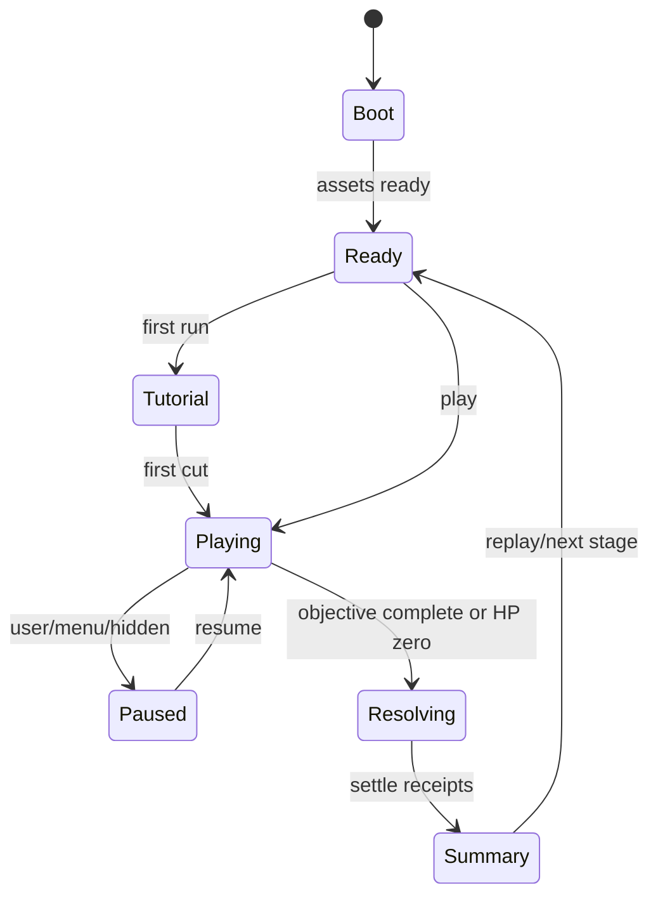

# Game design document — game as a system

## Fiction and win condition
A small guardian, **Miri**, protects the glowing **Heartseed** from animated corrupted fruits (Blights). Fruit enters from a readable upper spawn ribbon and travels toward the Wardline around the Heartseed at the lower center. The player attacks with direct finger/mouse gestures, not a physical sword joystick. The defender animates in response to slashes; it is an on-screen personality, not a second control requirement. Survive a 90-second stage with Heartseed HP > 0 and defeat the final threat. A stage fails when HP is 0; a boss stage also requires the boss's last guard segment to be defeated by the 90-second mark, with an optional 10-second telegraphed overtime grace in first-world stages only.

## Rules of play
- Initial HP 5, max 5; ordinary small Blight contact = 1 HP; heavy contact = 2 HP; shield absorbs one hit then breaks. Impacts within 250ms share a grace lock to avoid instant multi-hit death.
- Simulation at 60 ticks/s preferred; fixed-step with accumulator, maximum 4 catch-up steps; use real-time stage clock so background tab cannot be used to slow attacks. During tab hidden, pause and suspend score generation until explicit resume.
- A **stroke** begins on pointer down, follows pointer moves and ends on release, cancel or losing focus. Scored as one success if at least one enemy is cut; multiple cuts within same stroke can count individually but share one combo increment.
- A **streak** counts successful strokes; a single empty stroke does not end it immediately; two consecutive misses or 1.4s without a successful stroke reset it. At streak 3 multiplier 1.25; 6 => 1.5; 10 => 2.0; 18 => 2.5; 30+ => 3.0. Clean Cuts add a fixed +20% score for that enemy only. Max multiplier 3x.
- Each normal cut grants 8 Spark, Clean Cut grants +6 Spark, multi-hit stroke grants +4 extra once. Spark max 100. At 100, Bloom Burst happens after 200ms telegraph, clears ordinary Blights in visible radius, deals exactly one guard segment to bosses, and resets Spark to 0. It cannot trigger from secondary peel chains.
- **Peel Link:** on splitting specified Blights, a seed ping auto-targets up to three nearby minor Blights within 110 logical px each; secondary hits yield 30% base points but no Spark or chain self-trigger.
- Complete a stage with 0 Heartseed damage for **Pure Grove** badge. At stages 1–2, issue one soft tutorial rescue shield automatically when HP first drops from 5 to 4; remove after stage 2.

## Core loop by time
| Moment | System action | Player comprehension |
|---|---|---|
| 0–5s | Public page, instant PLAY; overlay `Swipe through the blights` appears while one slow apple approaches | Can attack with one finger |
| 5–15s | First easy hit, slice feedback, Heartseed pulse when an enemy slips through | Learns defend objective |
| 15–30s | Kiwi dart and grape cluster; streak and Spark growth; one banner `Perfect!` if Clean Cut | Reads enemy variation and skill |
| 30–60s | Armored coconut introduced with a two-cut tell; phase intensity escalates; first Bloom Burst possible | Learns strategy and payoff |
| 60–75s | Rush event; additional split fruit; background music intensifies | Survives pressure |
| 75–90s | Telegraph, wave captain/boss; controlled finale; stage clear or game over | Climactic short run |
| 90–105s | Run summary, Petals award, one next-step button and share chip | Wants another attempt |

## State machine

Use `runId` UUID for each run, and a `settled` boolean persisted before rewarding anything. No direct UI component may write coins independently.

## Difficulty, fairness and failure recovery
Six 15-second phases with per-phase budget `budget = floor(4 + 1.3*p + 0.6*stageIndex)` where `p` is 0–5; modifiers for boss reserves a portion of the budget. Spawn only if >450ms from last heavy enemy. Never put more than six active hazards within the bottom 28% viewport on low effects mode. A failed run still awards 50% stage Petals (capped) and offers free replay. A win unlocks next stage and a clear `Try harder mode` option. No timer pressure on monetization or login.

## Accessible control design
Touch: drag anywhere on active arena; browser page scroll disabled only on play surface while Playing, not across menus. Mouse: hold left button and drag. Optional desktop keyboard: Esc pause, Enter Play/Next; no core keyboard movement required. Pointer-follow trail is rendered immediately; enemy hit response preferably within 1 video frame after the qualified segment. Supports color-blind-friendly shape silhouettes, reduced motion, mute, high-contrast slash trail and oversized safe zone. Audio starts after first gesture.

## Stage goals and content budgeting
Contest M: **6 stages**, **2 Groves** (Sunlit Terrace and Lantern Marsh), 6 enemy archetypes, 1 large boss, 3 permanent upgrade types, 2 cosmetic trails, 1 tutorial. Endless is P; same-seed `Echo` works with a locally included deterministic challenge config. A stage score is only compared against runs with the same seed, balanceVersion and equipped gameplay modifiers; ranked Echo disables permanent stat boosts for fairness.

## Consequences and failure variants
Time-based stage failure cannot be revived by watching ads (none). Optional shield heals only within strict caps. Boss cannot attack during the 1.1s first tutorial overlay; a lost HP heart shows crisp `−1` animation and brief damage vignette. On failure, show `Heartseed saved for 63 seconds` rather than accusatory copy.

## Functional acceptance scenarios
**G1:** A touch drag through a strawberry removes it and emits audio/VFX once. **G2:** A touch through two normal Blights hits both but increments combo by one stroke. **G3:** Two missed strokes reset streak; one stray stroke does not. **G4:** HP of zero leads to Results and never keeps spawns running. **G5:** Pause freezes gameplay and disables swiping until Resume. **G6:** Closing browser after awarded results does not double-credit Petals. See [04](04-COMBAT-AND-SLASHING-SYSTEM.md), [07](07-ECONOMY-REWARDS-AND-BALANCING.md) and [17](17-QA-PERFORMANCE-AND-SECURITY.md).

---

> **Status:** v1.0 proposed production specification, 21 November 2026. **Numbers are design hypotheses** until verified by playtesting. This game is a new, original Base44 contest project. **Canonical terms:** Heartseed = defended object; Sprites = characters; Blights = hostile fruits; Petals = persistent free currency; Spark = transient run meter; Bloom Burst = earned special; Grove = level/world; Echo = same-seed challenge; Wardline = invisible defense boundary. **Scope codes:** V = vertical slice, M = contest MVP, P = post-MVP. Core baseline: 90-second stage, 5 Heartseed HP, pointer-only slashes, 60 Hz simulation when feasible, 3-minute-or-less replay loop. Unless this document explicitly overrides a value, these are binding defaults. See [00-README.md](00-README.md) and [03-GAME-DESIGN-DOCUMENT.md](03-GAME-DESIGN-DOCUMENT.md).
