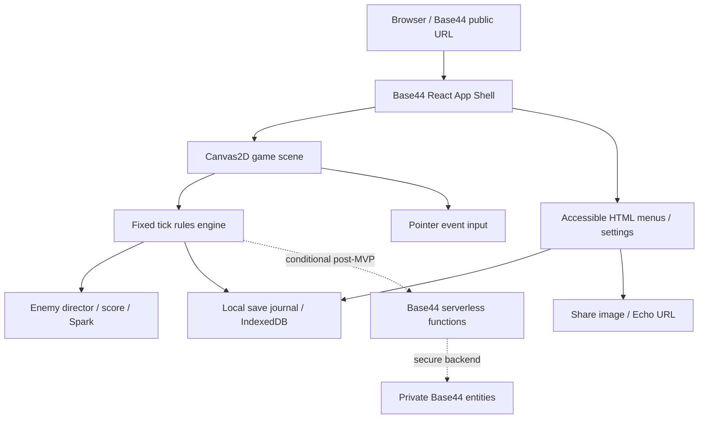

# Base44 architecture, feasibility gates and performance

## Verified platform capabilities (as of 21 Nov 2026)
Official Base44 documentation describes code editing in apps, npm package installation through Base44 AI chat with approval, GitHub integration, entities with access rules, and a managed backend with serverless TypeScript functions and JavaScript SDK; it also documents public `All Users` data access. These establish a plausible hybrid custom 2D-game UI. They **do not by themselves prove** a particular Phaser version, bundler configuration, anonymous backend invocation path, or third-party engine qualifies as *built using Base44* for contest purposes. Confirm those empirically in the actual Base44 project.
Sources: [npm packages](https://docs.base44.com/Building-your-app/NPM-packages), [developer tools](https://docs.base44.com/documentation/building-your-app/developer-tools), [permissions](https://docs.base44.com/Setting-up-your-app/Managing-security-settings), [contest terms](https://nitropay.com/base44webgame/terms-and-conditions/).

## Primary architecture: native Canvas2D embedded in Base44 application

**Base44 owns:** actual project creation, code, published Base44 URL, UI shell, menu states, optional persistence/backend functions. **Game code owns:** 60 Hz simulation, hit test, sprite draw, run state, audio management and deterministic event log. **Canvas2D beats Phaser for M** because the mechanics are simple circles/splines and a custom swipe path, and a tiny deterministic engine avoids package/network constraints. Phaser may be adopted only after spike tests prove installation, build output, input performance, bundle and direct Base44 hosting. No iframe to a secretly Vercel-hosted game; submitted playable engine must truly be within Base44 project.

## Base44-native vs hybrid decision
| Option | Pros | Risks | Decision |
|---|---|---|---|
| Only declarative React DOM for combat | Simplest menus and accessibility | High-frequency entities cause rerenders / collision awkward | Reject for combat |
| React shell + hand-written Canvas2D | Small dependency surface, direct geometry, portable code | Requires own animation loop/pooling | **Chosen** |
| React shell + Phaser npm | Scene tooling and debug utilities | Unproven package/size/mounting and extra complexity | Prototype fallback |
| External-hosted full game inside iframe | Easy custom frontend hosting | May fail `built using Base44` evidence and URL requirements | Do not use |

## Browser loop and game state
Rendering never mutates authoritative combat state. Use accumulator fixed timeStep=1/60 s, max 4 steps per animation frame; if total elapsed gap >250ms, classify it as suspension and pause rather than teleport simulation. Game state in plain TypeScript object, not React `useState` 60fps. React receives summary snapshots at ≤10Hz for accessible HUD and menu, canvas renders at rAF. Deterministic PRNG for wave configs; physical particle randomness is cosmetic only. Store complete `runReceipt` at finish, then journal Petals exactly once.

## Suggested code tree
```text
src/
  pages/Home.tsx
  components/GameCanvas.tsx, HUD.tsx, Results.tsx, Shop.tsx, Settings.tsx
  game/engine.ts, clock.ts, input.ts, collision.ts, director.ts
  game/enemies.ts, combat.ts, scoring.ts, rewards.ts, deterministic.ts
  game/render.ts, particles.ts, audio.ts, assets.ts
  game/config/{stages,enemies,upgrades}.ts
  services/localSave.ts, share.ts, replay.ts
  tests/{combat,director,economy,save}.spec.ts
  public/assets/{atlases,audio,backgrounds}/
```
Use whichever paths the Base44-generated app actually supports; this is a component boundary prescription, not an assertion about an existing repository.

## Cloud extension gates
G1: create Base44 test app during entry period; verify Canvas mounts and pointer event capturing on a published mobile URL. G2: confirm npm install if needed. G3: prove anonymous backend call only if cloud needed. G4: implement server-side ownership and authorization; if `All Users` read/write would expose private saves, fail closed. G5: verify race-safe reward settlement and replay anti-cheat before publishing global scores. With any G3–G5 failure, ship local-save MVP unchanged.

## Performance budget
Initial interactive within 3s on typical 4G after asset cache; core JS+styles <=450 KB compressed target; first-play image/audio ≤3MB; input-to-trail <=16ms typical 60fps and input-to-hit <=33ms; >95% frames under 16.7ms on mid-level desktop and ≥30 fps low-end Android; no more than 18 live enemies and 140 particle instances high tier. Use WebP sprite atlases, asset lazy load per Grove and cache manifests. DevicePixelRatio cap ≤2; fallback 1 on hot devices. Zero network requests are required to finish any stage after initial load.

## Production risk controls
- Cloud functions may differ by plan -> optional only, probe in project.
- Mobile browser rAF may throttle -> visibility pause, restore explicit resume.
- React remount could restart engine -> single owner/controller with disposal and event unsubscription.
- Secret in frontend or unauthenticated entity writes -> fail release gate.
- Guest high scores vulnerable -> local-only standings; never call them official globally verified.
- Game engine generated outside Base44 -> contest disqualification risk; retain Base44 project history and evidence.

## Deployment and observability
Set app public in Base44 Dashboard, publish to stable `*.base44.app` or officially provided Base44 URL, test as fresh user in private mode on real phones. Record only anonymized errors and session-safe performance telemetry; require user consent before tracking beyond essential crash diagnostics. Manual UI acceptance runs are assigned to the product owner; engineers run automated tests. See [17](17-QA-PERFORMANCE-AND-SECURITY.md), [18](18-CONTEST-COMPLIANCE-AND-SUBMISSION.md).

---

> **Status:** v1.0 proposed production specification, 21 November 2026. **Numbers are design hypotheses** until verified by playtesting. This game is a new, original Base44 contest project. **Canonical terms:** Heartseed = defended object; Sprites = characters; Blights = hostile fruits; Petals = persistent free currency; Spark = transient run meter; Bloom Burst = earned special; Grove = level/world; Echo = same-seed challenge; Wardline = invisible defense boundary. **Scope codes:** V = vertical slice, M = contest MVP, P = post-MVP. Core baseline: 90-second stage, 5 Heartseed HP, pointer-only slashes, 60 Hz simulation when feasible, 3-minute-or-less replay loop. Unless this document explicitly overrides a value, these are binding defaults. See [00-README.md](00-README.md) and [03-GAME-DESIGN-DOCUMENT.md](03-GAME-DESIGN-DOCUMENT.md).
