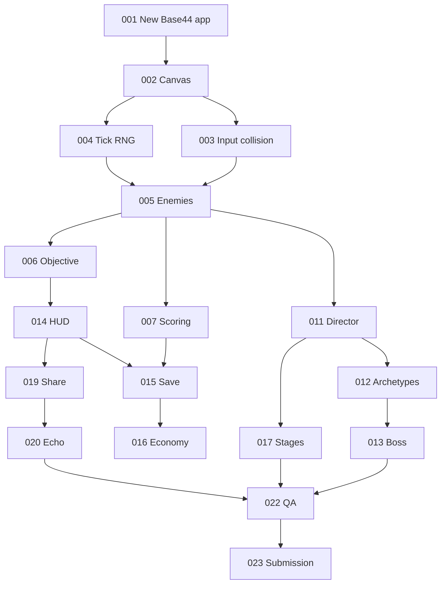

# Implementation task backlog — executable work packets

## Conventions
P0 = release blocker, P1 = contest MVP, P2 = later. XS < half day, S ~1 day, M 2–3 days; estimates are relative effort, not schedule guarantees. Each item states objective, dependencies, implementation, deliverable, acceptance criteria and an automated test. Manual UI/game-feel checks are assigned to the owner; engineers handle automation. Parallel tasks shown in groups. Code interfaces are in [04](04-COMBAT-AND-SLASHING-SYSTEM.md), [13](13-BASE44-TECHNICAL-ARCHITECTURE.md), [14](14-DATABASE-AND-API-SPECIFICATION.md).

| ID | Priority / size | Objective & implementation detail | Dependency | Deliverable and acceptance/test |
|---|---|---|---|---|
| ENG-001 | P0 S | Create a **new** Base44 app, verify app public access, project provenance | None | URL opens in private mode; screenshot test and metadata |
| ENG-002 | P0 S | Embed Canvas2D component with resize observer, safe insets and cleanup | 001 | 390×700 logical view on phone/desktop; size snapshot |
| ENG-003 | P0 M | Pointer stroke collector, capture, screen-to-world mapping, capsule collision | 002 | Segment-circle fixtures pass at DPR 1/2; gesture integration |
| ENG-004 | P0 S | Fixed tick loop, safe pause/visibility state, seeded RNG | 002 | Deterministic fixture hash and no double rAF |
| ENG-005 | P0 M | Entity system and 3 initial Blight types with collision | 003,004 | Scout/dart/coconut tests, no duplicate hits |
| ENG-006 | P0 S | Heartseed HP/contact grace, win/fail and run reset | 005 | 5 HP; 250ms grace; Cypress/Playwright route replay |
| ENG-007 | P0 M | Score, streak, Clean Cut and Spark/Bloom state machine | 005 | Exact scoring worked cases; property-based cap tests |
| ENG-008 | P0 S | Adaptive VFX object pool and score popups | 003,005 | 1000-hit memory stability, no leaking listeners |
| ENG-009 | P0 M | Original core art atlas: guardian, Heartseed, first 3 enemy silhouettes | Art brief; parallel | Readability at 48px; image export test |
| ENG-010 | P0 S | Audio manager with post-gesture unlock, volume settings, cleanup | 002; art/audio | No blocked autoplay crash; load/suspend integration |
| ENG-011 | P0 M | Stage director with phase budgets, spawn ceilings and fixed seeds | 004,005 | 100-run spawn config hash identical |
| ENG-012 | P1 M | Add grapes, lime, dragonflare; capped fragments/projectiles | 011 | Each enemy unit fixture, no recursive splinter loops |
| ENG-013 | P1 M | Warden Pom three-wedge boss and win precedence | 011,012 | Fatal sector before 90s is victory; boss golden fixture |
| ENG-014 | P0 S | Accessible HTML HUD, pause, result and retry UI | 002,006 | Large touch targets and Pause/resume keyboard tests |
| ENG-015 | P1 M | Local save schema, validation, crash-recoverable transaction journal | 006,007 | Relaunch restores, duplicate receipt idempotent |
| ENG-016 | P1 S | Free Petals payouts and three charm upgrades | 015 | No negative balance; exact price config tests |
| ENG-017 | P1 M | Stage map and six 90s stage configurations | 011,014 | All stage entrances/clears accessible from menu |
| ENG-018 | P1 M | Two original Grove backgrounds with high-contrast variants | 009 | Sprite contrast snapshots at 320px and desktop |
| ENG-019 | P1 S | Result card offscreen PNG + Web Share fallback | 014,015 | PNG renders 1080×1350; fallback download |
| ENG-020 | P1 M | Echo seed parser/generator with standardized equipment | 011,019 | Same seed produces same spawns; malformed links safe |
| ENG-021 | P0 M | Accessibility toggles and performance automatic quality | 008,010,014 | Reduced-motion snapshots and 30/60fps target checks |
| ENG-022 | P0 M | E2E P0 flows on 3 browsers and two phones | 013–021 | Report no P0 failures, visual regression threshold |
| ENG-023 | P0 S | Verify Base44 public domain, asset licenses and official submission details | 001,022 | Official URL and contest checklist signed by owner |
| ENG-024 | P1 XS | Create 15–30s gameplay promo clip and truthful Launchpad listing | 023 | No lifted audio/assets, accurate gameplay capture |
| ENG-025 | P2 L | Cloud guest recovery and rotating high-entropy codes | 015, backend feasibility | Secure guest access penetration tests; flag OFF until verified |
| ENG-026 | P2 L | Verified public leaderboard with server replay | 025,011 | Forged score rejected; verified scores only |

## Individual engineering acceptance recipes
**ENG-003:** Inject synthetic points with a 5px x 5px touch motion across a circular Blight, assert `cutCount===1` and no cut for geometrically nonintersecting segment. Test Safari pointercancel and lost capture. **ENG-004:** Advance test clock 90,000ms at synthetic 30fps and 120fps and compare state/damage; hidden tab must transition Paused without awarding 30s progress. **ENG-007:** Run score examples in doc 07 and compare exact 100,252,870. **ENG-011:** Assert threat budget ceilings and ≤6 urgent enemies. **ENG-015:** Replay the same run settlement 10 times, award once. **ENG-020:** Fuzz 10k malformed challenge payloads, no crashes and no guest data disclosure. **ENG-021:** A 1000-frame particle stress must stay under configured object cap at all quality modes. **ENG-023:** Submit proof including project birth date within contest period and no-login private window screen recording.

## Dependency graph

## Independent parallel lanes
After ENG-002: UI shell (014), art (009/018), audio (010), engine/input (003/004) proceed. Do not ask art to implement unapproved hitboxes: gameplay engineer specifies silhouettes/hurtboxes and art matches them. After ENG-015: backend optional P2 work must not block contest. All PRs must update relevant docs and fixtures. Assign each ID to one named owner and track `TODO/In progress/Review/Passed`, with blockers and screenshots; this is ready to import into project management.

---

> **Status:** v1.0 proposed production specification, 21 November 2026. **Numbers are design hypotheses** until verified by playtesting. This game is a new, original Base44 contest project. **Canonical terms:** Heartseed = defended object; Sprites = characters; Blights = hostile fruits; Petals = persistent free currency; Spark = transient run meter; Bloom Burst = earned special; Grove = level/world; Echo = same-seed challenge; Wardline = invisible defense boundary. **Scope codes:** V = vertical slice, M = contest MVP, P = post-MVP. Core baseline: 90-second stage, 5 Heartseed HP, pointer-only slashes, 60 Hz simulation when feasible, 3-minute-or-less replay loop. Unless this document explicitly overrides a value, these are binding defaults. See [00-README.md](00-README.md) and [03-GAME-DESIGN-DOCUMENT.md](03-GAME-DESIGN-DOCUMENT.md).
